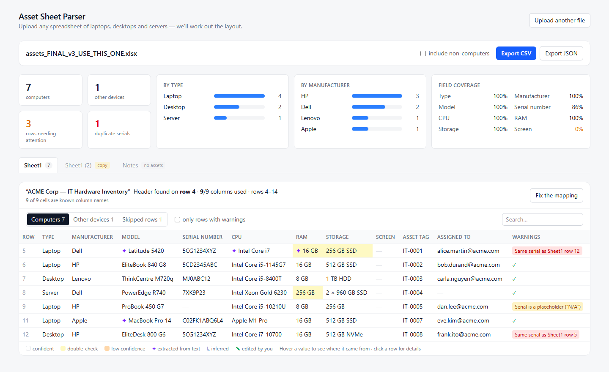

# Asset Sheet Parser

Upload any spreadsheet listing laptops, desktops and servers — whatever its layout — and get a clean, reviewable, exportable inventory.



- **Any layout**: header on row 4 under a title, no header at all, two-row merged headers, two tables in one sheet, several sheets, a “Sheet1 (2)” copy nobody dares delete.
- **Any wording**: “RAM”, “Mem”, “Memmory”, “Mémoire vive”; `16 gig`, `16384 MB`, `2x8GB`, `16 Go` → **16 GB**.
- **Combined fields**: `HP EliteBook 840 G8 / i5 / 16GB / 256GB SSD / 14in` → seven separate fields.
- **Explains itself**: every value carries a confidence score and its provenance (original text, source column, how it was obtained).
- **Fixable**: when a guess is wrong, change the column mapping, the header row or a single cell — results update instantly.
- **Private**: files are parsed entirely in the browser. Nothing is uploaded; no backend, no API key.

---

## Quick start

```bash
npm install
npm run dev          # http://localhost:3001
npm test             # 160 unit, end-to-end and robustness tests
npm run fixtures     # regenerate the messy test spreadsheets
npx tsx scripts/inspect.ts path/to/file.xlsx   # print what the parser makes of any file
```

Requires Node 20+. Both `npm run dev` and `npm run start` explicitly use **port 3001**. Port **3000 is reserved for another server**; do not use it or stop its process. For production mode, run `npm run build` followed by `npm run start`.

Tip: `http://localhost:3001/?sample=assets_FINAL_v3_USE_THIS_ONE.xlsx` opens a sample directly.

---

## How it works

### Agent instructions and quality requirements

Coding agents must read [AGENTS.md](AGENTS.md). [CLAUDE.md](CLAUDE.md) points Claude to the same shared rules. See [engineering/security rules](docs/ENGINEERING-RULES.en.md), [quality metrics and gates](docs/QUALITY-GATES.en.md), and [official attachment findings](docs/RESOURCE-REVIEW.en.md). These are project instructions and documented targets; automated CI enforcement has not yet been added.

The parser is a **pure TypeScript pipeline** (`src/lib`, no React, fully unit-tested). The UI only calls two functions:

```ts
readWorkbook(fileName, bytes)        // file → raw grid per sheet        (throws user-friendly IngestError)
analyzeWorkbook(raw, overrides)      // grid → assets, mapping, warnings (pure, re-run on every user correction)
```

```
 File ─► 1 Ingest ─► 2 Sheets ─► 3 Find tables & headers ─► 4 Map columns ─► 5 Extract rows ─► 6 Classify rows ─► 7 Quality
                                       ▲                          ▲                ▲
                                       └──── user overrides (header row, column mapping, cell edits) ────┘
```

| Step | File | What it does |
|---|---|---|
| 1. Ingest | `parser/ingest.ts` | Sniffs the real format from magic bytes (not the extension). SheetJS for xlsx/xls/ods, Papa Parse for CSV with delimiter auto-detection (`,` `;` tab `|`) and UTF-8 → Windows-1252 fallback. Fills merged cells. Keeps real spreadsheet row numbers. Clear errors for corrupt, password-protected, empty, oversized or unsupported files. |
| 2. Sheets | `parser/pipeline.ts` | Empty sheets are skipped; a sheet whose rows are ≥ 90 % contained in an earlier sheet is flagged as a **copy** and excluded from totals (one click to include it). Hidden sheets are badged. A sheet that fails never takes the others down. |
| 3. Tables & headers | `parser/tableDetector.ts` | Splits a sheet into blocks separated by blank rows, then scores the first 25 rows of each block as header candidates (see below). Handles title rows, no header, two-row grouped headers, a second table under the first, repeated header rows, section titles (“LAPTOPS”). |
| 4. Column mapping | `parser/columnMapper.ts`, `parser/headerMatch.ts` | Scores every (column, field) pair from **header text and cell contents**, then assigns greedily. |
| 5. Row extraction | `parser/rowExtractor.ts`, `extract/*` | Three passes: mapped columns → free-text parsing → inference. |
| 6. Row classification | `parser/rowClassifier.ts` | Computer / other device (monitor, dock, keyboard, phone…) / skipped (totals, repeated headers, notes). Nothing is deleted. |
| 7. Quality | `parser/quality.ts` | Duplicate serials (case/dash-insensitive, across sheets), placeholder serials (`N/A`, `TBD`, `000000`), RAM that is really MHz (`2400`), implausible sizes, expired warranties, low-confidence values; fleet summary. |

### Finding the header row

Each candidate row gets a score from simple, explainable signals:

| Signal | Why |
|---|---|
| Share and number of cells that match known column names | strongest evidence |
| Share of short **label-like** text (no digit runs: `RAM (GB)` yes, `512GB SSD` no) | headers aren't data |
| All values distinct | headers rarely repeat |
| Rows below have a similar width | a table actually hangs under it |
| Width close to the widest row | a lone “IT Inventory 2024” cell is a title |

If no row is convincing, the table is treated as **header-less** and columns are identified from their values only. If the first row is all distinct labels but in an unknown vocabulary (e.g. German), it is still accepted as a header with low confidence — content detection does the rest (see `16_german_headers.xlsx`: every column is mapped correctly with zero German vocabulary).

### Mapping columns to fields

```
score(column, field) = 0.55 × header evidence + 0.45 × content evidence
```

- **Header evidence** (`headerMatch.ts`): normalised header (lower case, accents and units stripped: `Mémoire (Go)` → `memoire`) compared to an EN + FR vocabulary (`knowledge/synonyms.ts`): exact = 1.0, contains a synonym = 0.7–0.95, weak synonym (`Name`) = 0.4–0.6, typo (Jaro-Winkler ≥ 0.9, `Memmory`) = 0.65. **Veto words** cut the score (`RAM slots`, `Monitor serial`, `Disk type`).
- **Content evidence**: each field has a `contentScore(cell)` detector (`extract/registry.ts`); the column score is the average over up to 50 samples. Extra rules: serials must be mostly unique; categories must repeat; a `1, 2, 3…` column is a row index.
- **Adjustments**: no header → content only; header claims a field but no value looks like it → header evidence × 0.7; known non-asset columns (`Qty`, `Price`, `IP address`) → content × 0.3.
- **Assignment**: all pairs sorted by score, assigned greedily, one column per field (except free-text targets). So when two numeric “GB” columns compete for RAM, the more RAM-like wins and the other falls back to Storage.
- **Confidence** = score, reduced when the runner-up is close (ambiguous). The “Why” column in the mapping screen shows the reasons and the runner-up.

### Extracting values

1. **Column** — the mapped cell goes through the field's normaliser (`extract/ram.ts`, `storage.ts`, `cpu.ts`, `screen.ts`, `manufacturer.ts`, `model.ts`, `serial.ts`, `assetType.ts`, `misc.ts`). Header units are used for bare numbers (`RAM (MB)`: `8192` → 8 GB).
2. **Parsed** — description columns, and any Model cell that packs specs (`Dell Lat 5420 i7 16GB`), go through `extract/combined.ts`. It extracts the least ambiguous things first and *masks* them out of the string: storage (has SSD/HDD/TB) → RAM (remaining GB) → screen (inch marks) → CPU → OS → manufacturer → product family → the leftover segment is the model.
3. **Inferred** — product families (`knowledge/modelFamilies.ts`, ~80 lines: Latitude → Dell laptop, PowerEdge → Dell server, `DL380` → HPE ProLiant server…) fill the manufacturer and type; then section titles, sheet names (“Servers”), hostname prefixes (`SRV-`, `LAP-`), server-class CPUs, built-in screens.
4. Nothing found → empty. **Values are never invented.**

Confidence = normaliser confidence × mapping confidence; parsed and inferred values are capped lower. In the table: yellow = double-check (50–80 %), orange = low (< 50 %), ✦ = extracted from text, ↳ = inferred, ✎ = edited. Hover any value for its provenance; click a row for the full details next to the original row.

### Normalisation examples

| Field | Input | Output |
|---|---|---|
| RAM | `16`, `16GB`, `16 gig`, `16 Go`, `16384 MB`, `2x8GB`, `8+8 GB` | `16 GB` (2400 → flagged as MHz) |
| Storage | `256GB SSD`, `0.5 TB`, `512 Go NVMe`, `1TB HDD + 256GB SSD`, `4x 1.2TB SAS HDD` | total GB + drives with type |
| CPU | `Intel(R) Core(TM) i5-8250U CPU @ 1.60GHz`, `i7`, `Ryzen 5 PRO 4650U`, `Xeon E5-2620 v4`, `M1 Pro` | `Intel Core i5-8250U`, … |
| Screen | `14"`, `14in`, `14''`, `15,6 pouces`, `35.6 cm`, `15.6 FHD` | inches |
| Manufacturer | `Hewlett-Packard`, `hp inc.`, `DELL INC.`, `Hewlett Packard Enterprise` | `HP`, `Dell`, `HPE` |
| Model | `Lat 5420`, `HP EB 840 G8`, `DL380 Gen10` | `Latitude 5420`, `EliteBook 840 G8`, `ProLiant DL380 Gen10` |
| Serial | ` s/n: 5cg 1234 xyz ` | `5CG1234XYZ`; `N/A`, `TBD` → missing + warning |
| Type | `Notebook`, `PC portable`, `PC fixe`, `Serveur`, `VM`, `Écran` | `laptop`, `desktop`, `server`, `virtual-machine`, `monitor` |
| Dates | Excel dates/serials, `2023-04-01`, `15/04/2023`, `04/15/2023`, `5 May 2023`, `1er avril 2023` | ISO, time-zone independent; ambiguous `01/02/2023` → day-first, lower confidence; impossible dates (`31/02`) rejected |

---

## Design decisions & trade-offs

- **Heuristics first, no LLM in the app (yet).** Deterministic, instant, works offline, free, testable, and every decision can be explained in the UI. The weak spot is vocabulary it has never seen — mitigated by content-based detection and the mapping editor. An LLM would be a good *fallback* for low-confidence columns only (see “Next steps”); it was left out to keep the demo reliable and private.
- **Content beats headers when they disagree.** Headers are short and inconsistent; 50 values are strong evidence. That's why German headers and header-less files still work.
- **Client-side only.** Asset lists contain serials and employee names. Parsing in the browser means no upload, no storage, no GDPR question — and no backend to deploy.
- **A pure pipeline + overrides instead of mutable state.** `analyzeWorkbook(raw, overrides)` is a pure function, fast enough to re-run on every keystroke-level change. User corrections are just data (`Overrides`), so the result is always consistent and corrections survive re-analysis.
- **Never delete, never invent.** Peripherals and skipped rows remain visible with a reason and can be moved back; missing values stay empty.
- **Knowledge is data.** Column vocabulary, brands and product families live in `src/lib/knowledge/`, separate from logic. Supporting a new language or brand is a data change.
- **Strict TypeScript.** `strict` + `noUncheckedIndexedAccess`; no `any`. `FieldValueMap` ties each field to its value type, so `asset.fields.ramGB.value` is a `number` and `asset.fields.storage.value` a `StorageValue` everywhere.
- **Storage in decimal, RAM in binary.** Disks are sold in decimal units (1 TB = 1000 GB), RAM in binary (16384 MB = 16 GB).

## Tested messiness

See the [manual test guide](docs/MANUAL-TEST.en.md) for browser test steps and the [independent verification report](docs/VERIFICATION.en.md) for executed checks, coverage limits and open findings.

`npm run fixtures` generates the files in `tests/fixtures/`; `tests/e2e-parse.test.ts` asserts on all of them:

| Fixture | Mess |
|---|---|
| `01_clean.csv` | baseline |
| `02_assets_FINAL_v3_USE_THIS_ONE.xlsx` | the brief's story: title rows, header on row 4, `Asset #`/`Device`/`Make`/`S/N`/`Mem`/`HDD`, stuffed model cell, `16 gig`, `8192 MB`, `hewlett-packard`, `N/A` serial, monitor row, duplicate serial, `TOTAL` line, `Sheet1 (2)` copy, `Notes` sheet |
| `03_french_semicolon.csv` | French headers, `;`, Windows-1252, `16 Go`, `1 To`, `14 pouces`, dd/mm/yyyy dates |
| `04_combined_description.xlsx` | everything in one `Description` column, row-number column |
| `05_multi_sheet.xlsx` | one sheet per type, units in headers, hidden lookup sheet, empty sheet, warranty dates |
| `06_no_header.csv` | no header row |
| `07_mixed_units.xlsx` | every way of writing units, RAM given in MB and in MHz by mistake, cm screens |
| `08_peripherals_and_totals.xlsx` | monitors/keyboards/docks/mice mixed in, Qty/Price columns, total row |
| `09_merged_two_row_header.xlsx` | merged group header above the column header |
| `10_two_tables_one_sheet.xlsx` | two tables with different columns and section titles in one sheet |
| `11_weird_column_names.xlsx` | `Proc`, `Mfr`, `Memmory`, `Form Factor`, shuffled order |
| `12_duplicates.csv` | duplicates differing by case/dashes, placeholder serials |
| `13`–`15` | empty workbook, corrupt file, PDF |
| `16_german_headers.xlsx` | vocabulary the app doesn't know |

## Security & robustness

An uploaded file is untrusted input. A dedicated audit ([`docs/AUDIT.en.md`](docs/AUDIT.en.md)) probed the app with hostile and edge-case files; each finding has a regression test in `tests/unit/robustness.test.ts`.

| Risk | Protection |
|---|---|
| **Formula injection** in the exported CSV (`=HYPERLINK(…)` from the source file running in Excel) | Text cells starting with `=` `+` `-` `@` (also after spaces, multi-line or full-width) are prefixed with `'` |
| **ReDoS**: a long digit run made one regex backtrack for > 15 s | Bounded quantifiers (`\d{1,7}`) + "not inside a number" lookbehind → 80 ms; cells clipped at 2,000 chars |
| **Size bombs**: formatting a whole column makes Excel declare 1M rows (39 s, 1 GB) | Only the cells that hold values are read (15 ms); limits of 100k rows / 300 columns, always reported to the user |
| **Time zones**: Excel dates shifted by a day east of UTC | Calendar dates re-anchored to UTC at ingest; tested in 6 zones from UTC−11 to UTC+14 |
| **Prototype keys**: a sheet or brand named `__proto__` / `constructor` | Own-property lookups and prototype-less counters |
| **XSS** | No raw-HTML sinks; React escapes everything |
| **Crashes** | 800 fuzzed workbooks through pipeline, overrides and export: 0 crashes (a seeded subset runs in CI) |
| **Dependencies** | `npm audit --omit=dev`: 0 vulnerabilities; SheetJS from its official CDN (the npm build has known CVEs) |

## Known limitations

- **Provisional 20 MiB input limit** (currently labeled “20 MB” in the UI). This is an initial resource guardrail for browser-local parsing, not a benchmark-proven safe maximum or a challenge requirement. Larger files must currently be reduced/split and processed separately; cross-file reconciliation is manual. See [the decision and large-file roadmap](docs/ADR-001-FILE-SIZE-LIMIT.en.md).

- Transposed tables (one asset per column) and key/value “form” layouts are not detected.
- Header vocabulary covers English and French; other languages rely on content detection (works well for specs and serials, less for user/location columns).
- Model-family knowledge covers the major business lines (Dell, HP/HPE, Lenovo, Apple, Microsoft, Asus, Acer, Fujitsu, Dynabook, Panasonic, Supermicro…); unknown brands are kept as-is with a lower confidence.
- Ambiguous dates (`01/02/2023`) are assumed day-first.
- Parsing runs on the main thread; responsiveness and peak memory on large files have not been benchmark-validated. A worker with cancellation/timeout and a virtualized table are planned, but neither provides a hard parsing-memory limit. Current row/column limits apply after decoding and do not contain decompression bombs.
- `.xlsb` and password-protected files are not supported (the latter gets a clear message).

## Next steps

1. **LLM fallback for low-confidence columns** — send only headers + 5 sample values per unclear column (never the whole file) to a small model, validate the JSON answer, and treat it as one more scored suggestion (`method: "llm"`) that the user can accept.
2. **Remember corrections** — store user mappings per header text, so the next file from the same team maps itself.
3. Web Worker + virtualised table for 100k-row files; transposed-table detection; `.xlsb`.

## Project structure

```
src/
  app/                 Next.js App Router page (client-side flow: upload → review → export)
  components/          UploadZone, ResultView, FleetSummary, TableSection, AssetTable, MappingEditor, AssetDrawer, ErrorPanel
  lib/
    types.ts           domain types (Asset, ExtractedValue<T>, ColumnMapping, Overrides…)
    parser/            ingest → tables → mapping → rows → classification → quality (pure)
    extract/           one normaliser per field + free-text parser + registry
    knowledge/         vocabulary, manufacturers, product families (data only)
    export.ts          CSV / JSON export
scripts/               fixture generator, inspect CLI
tests/                 unit tests per normaliser, combined parser, end-to-end on every fixture, robustness/security
docs/                  brief, requirements, plan, security & robustness audit (AUDIT.en.md)
```

## How AI was used

- **Claude Code** (Anthropic) was used as a pair programmer throughout: analysing the brief, writing the original Vietnamese planning draft (the maintained English adaptation is [docs/PLAN.en.md](docs/PLAN.en.md)), and generating most of the code, tests and fixtures under my direction. I reviewed the design, ran the app and the tests, and iterated on the heuristics by inspecting real parser output on each fixture (`scripts/inspect.ts`) — several rules (label-like header cells, the row-index column, the `To`/`Assigned To` unit clash, the corrupt-zip vs password message) came from that loop.
- **No LLM runs inside the app.** All extraction is deterministic code in this repository.
- **Codex** assisted with independent source/fixture review, probing the official attachments, and preparing the English plan, agent rules, security criteria and manual test documentation. The verification reports distinguish executed checks from untested browser behavior and record unresolved defects; documentation does not imply those defects have been fixed.
